# BeautifulSkins

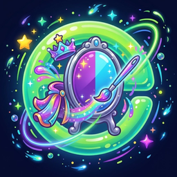

A modern, flat look for **Attune**, **RestedXP Guides**, **GearQuest Forever**, **SkillUp Forever**, **Whisper
Messenger**, **Waypoint UI** and **OpenMap** on **World of Warcraft: Forever**, in one addon. It contains BeautifulAttune and
BeautifulRestedXP (formerly EUI RestedXP Skin): install BeautifulSkins and you have them all.

BeautifulSkins restyles the windows, trackers and markers of these addons while you play. Their data and logic stay
exactly as they are; BeautifulSkins only changes how things look. Every skin switches itself on when its addon is
loaded and stays silent otherwise, so install only the addons you use.

> Unofficial. Not affiliated with or endorsed by the authors of Attune, RestedXP, GearQuest Forever, SkillUp Forever,
> Whisper Messenger, Waypoint UI, OpenMap or EllesmereUI. The skinned addons are installed separately. EllesmereUI is optional. No code, graphics or
> texts from these addons are included.

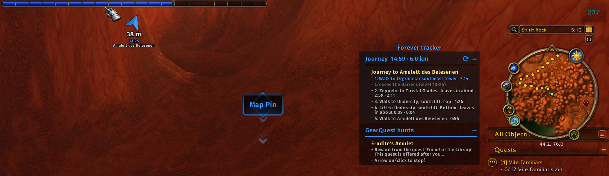

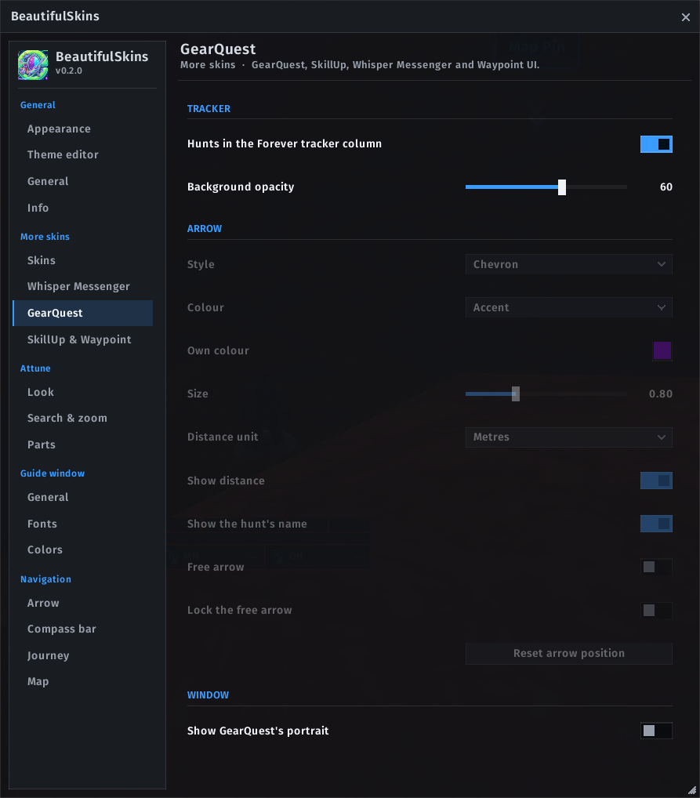

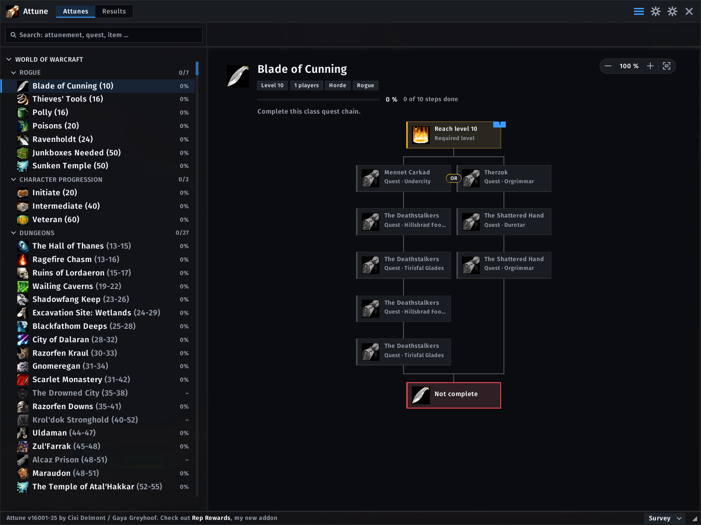

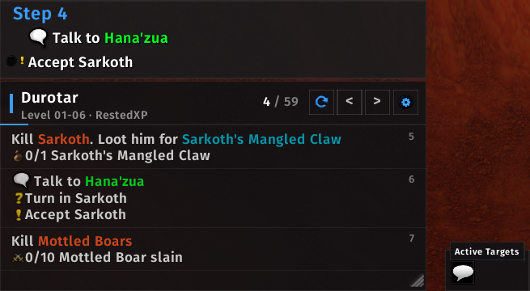

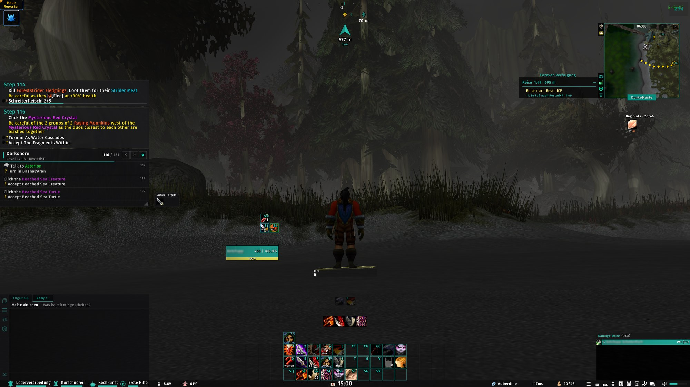

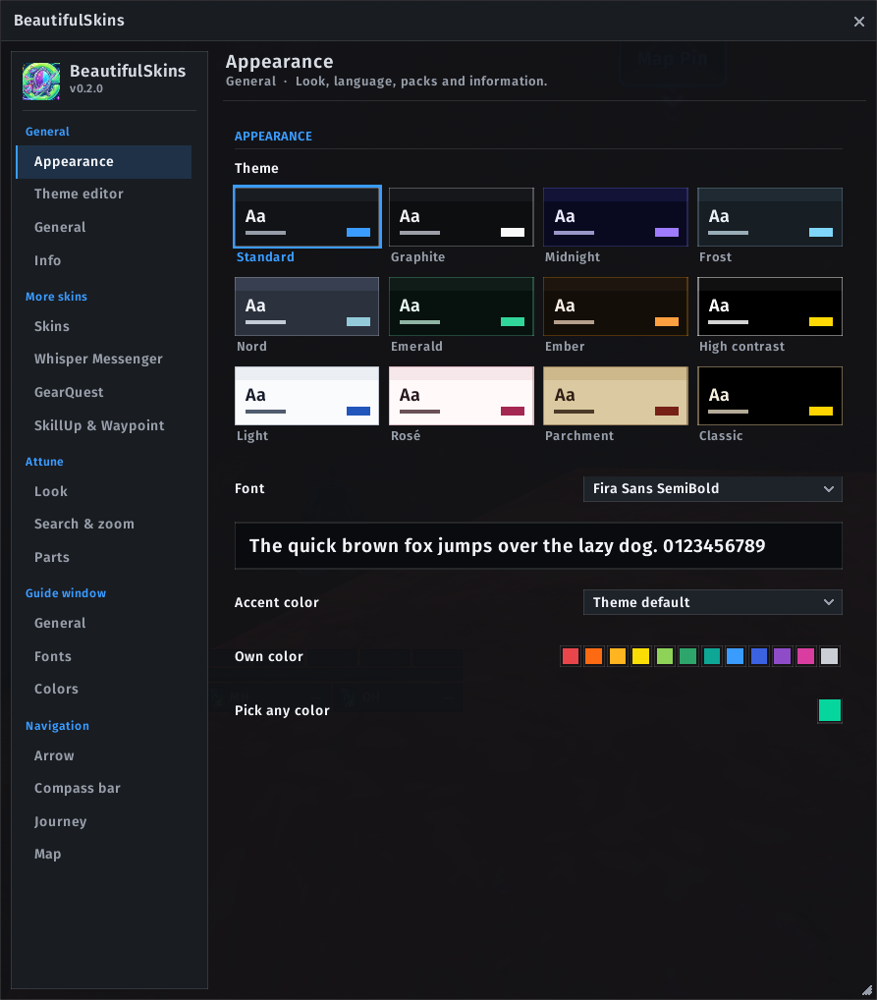

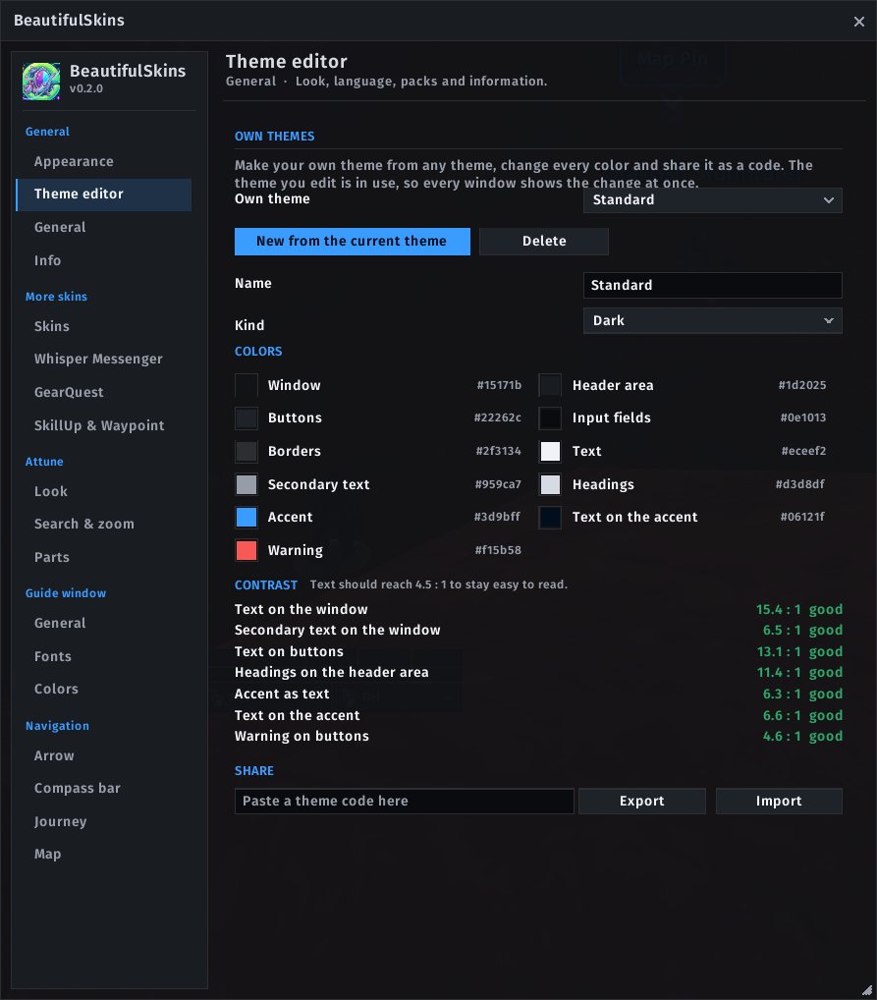

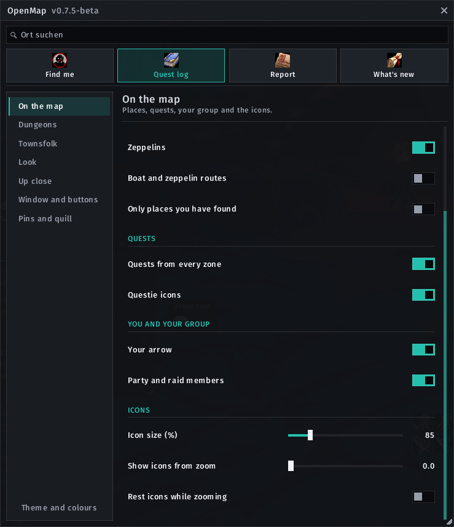

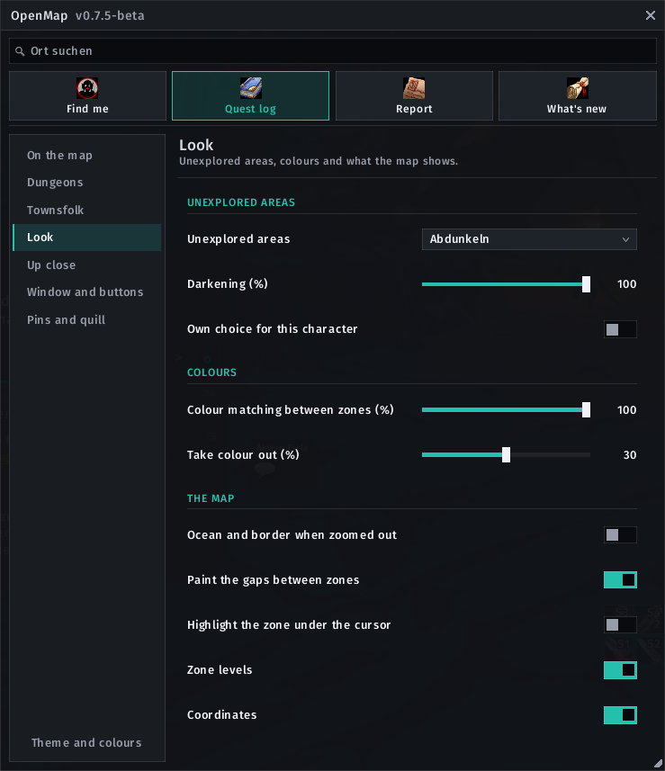

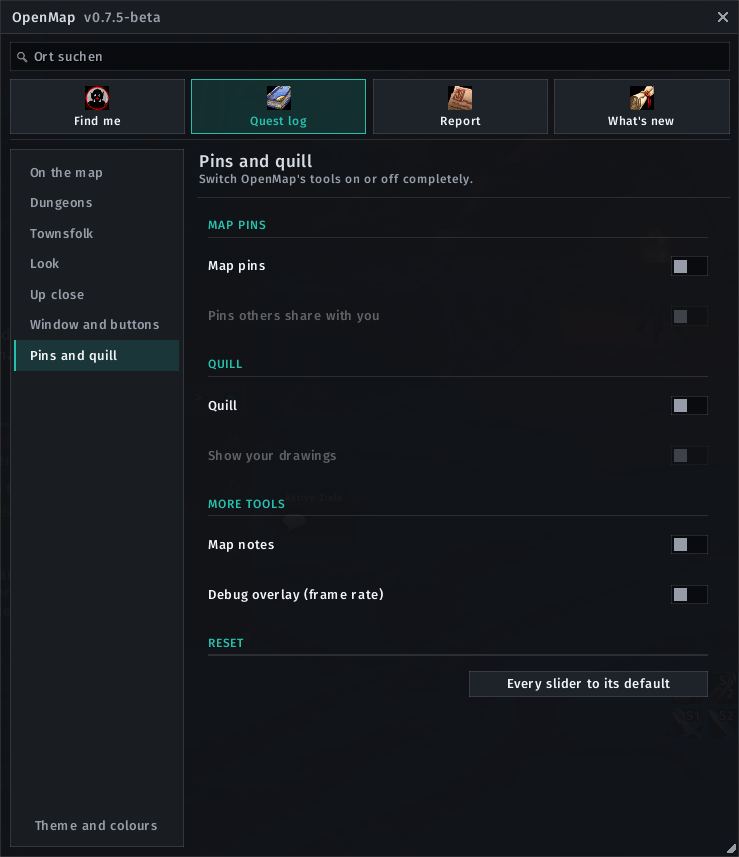

## Skins

- **Attune** – a flat window, tidy list and readable chain cards, plus a **search with filters** (attunements, quests,
  NPCs, items, zones) and a **zoom bar** from 10 to 150 %. Its second window, **Attune: Next**, gets the same look, and
  two header buttons switch that window on and off and open Attune's own options. Attune keeps doing all the work.
- **RestedXP Guides** – the guide window in a compact, flat look (header with step counter, progress bar, current step
  and upcoming steps), pinned item and target boxes, and a **navigation arrow** fed by ShortestPathForever with
  distance, arrival time and transport states; ShortestPathForever's journey and compass in the same look.
- **GearQuest Forever**
  - **Tracker** in the look of the EllesmereUI quest tracker: accent heading with a divider, background, readable hunt
    names and descriptions, flat "Enable Guide" boxes.
  - **Or one tracker for everything:** the hunts as a section of the Forever tracker column, together with Shortest Path
    Forever's journey and SkillUp's reagents (left click: arrow on/off, right click: open the hunt).
  - **Arrow** with four styles (Chevron, Ring, Pill, Classic), colour by accent, by direction or your own colour, size,
    yards or metres, the distance and the hunt's name. Above the tracker or free and movable. With RestedXP Guides and
    Shortest Path Forever your hunts run as journeys on the **same arrow** as the guide, and one switch goes back and
    forth between the two.
  - **Window**: dark flat panels instead of metal edges and parchment, flat buttons, check boxes and scroll bars, light
    text, the accent instead of the classic gold. Item quality colours stay.
  - **Popups and toasts**: the upgrade bar at the character panel, "Hunt obtained" and the portrait guide's bubble.
- **SkillUp Forever** – the tracked reagents section in the Forever tracker column in the EllesmereUI quest tracker look.
- **Whisper Messenger**
  - Its dark preset, flat frame and the EllesmereUI font.
  - A **chat button**: with EllesmereUI Chat it sits in the chat sidebar below the last icon and looks like the other
    sidebar icons (Shift-drag with "Free Move Icons"); without it, in a corner of the chat window. It shows the number of
    unread whispers and glows while one waits. Whisper Messenger's own floating and minimap icons can be hidden.
- **Waypoint UI** – waypoint, beam, pinpoint and navigator arrow in the accent colour, the texts in the EllesmereUI font.
  Or keep Waypoint UI's quest state colours.
- **OpenMap** – a new map menu instead of OpenMap's own: the place search on top, one row of quick buttons (find me,
  quest log, pins, quill, report a problem, what's new) and every setting sorted into eight clear pages with switches,
  sliders and choices; settings that depend on another are greyed until they apply. The same pages are in the
  BeautifulSkins options. **Map pins** and the **quill** can each be switched off completely, and on again with
  everything you had.

## Look and options

Thirteen themes (Standard, Graphite, Midnight, Frost, Nord, Emerald, Ember, High contrast, Light, Rosé, Parchment,
Classic and, with EllesmereUI, EllesmereUI) with a gallery, a **theme editor** for your own themes (every colour free,
live contrast check, export and import as a code), bundled fonts (Inter, Fira Sans, Barlow) or the game font, and an
accent colour from the theme, your class or your own choice. All options live in one window: General (appearance,
language, minimap button, skins) and one section per skin.

With **EllesmereUI** (optional) the skins follow its accent colour (live), font and language, and the options appear as
a section "Beautiful Skins" in EllesmereUI's options window (can be switched off). Without it, BeautifulSkins opens its
own window. Settings of BeautifulAttune and EUI RestedXP Skin are taken over on the first start; switch those addons off
afterwards.

## Commands

- `/bskins` – options
- `/bskins status` – state of every skin
- `/bskins minimap` – show or hide the minimap button
- `/bskins reset` – reset all settings
- `/battune` – Attune skin (`/battune diag` for bug reports)
- `/brxp` – RestedXP skin (`/brxp lock`, `/brxp target`, `/brxp probe` for bug reports)

Each skin can be switched off on its own (takes effect after `/reload`).

## Install

Install it through CurseForge, or copy the folders `BeautifulSkins`, `BeautifulSkins_Extras`, `BeautifulSkins_Attune`
and `BeautifulSkins_RestedXP` into `World of Warcraft\_forever_\Interface\AddOns` (WoW: Forever). Restart the game after
adding folders.

## Languages

English and German.

## License

MIT, see `LICENSE`.
