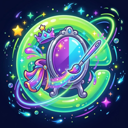

# BeautifulSkins

A modern, flat look for **GearQuest Forever**, **SkillUp Forever**, **Whisper Messenger** and **Waypoint UI** on
**World of Warcraft: Forever**, in one addon.

BeautifulSkins restyles the windows, trackers and markers of these addons while you play. Their data and logic stay
exactly as they are; BeautifulSkins only changes how things look. Every skin switches itself on when its addon is
loaded and stays silent otherwise, so install only the addons you use.

> Unofficial. Not affiliated with or endorsed by the authors of GearQuest Forever, SkillUp Forever, Whisper Messenger,
> Waypoint UI or EllesmereUI. The skinned addons are installed separately. EllesmereUI is optional. No code, graphics or
> texts from these addons are included.

## Skins

- **GearQuest Forever**
  - **Tracker** in the look of the EllesmereUI quest tracker: accent heading with a divider, background, readable hunt
    names and descriptions, flat "Enable Guide" boxes.
  - **Or one tracker for everything:** the hunts as a section of the Forever tracker column, together with Shortest Path
    Forever's journey and SkillUp's reagents (left click: arrow on/off, right click: open the hunt).
  - **Arrow** with four styles (Chevron, Ring, Pill, Classic), colour by accent, by direction or your own colour, size,
    yards or metres, the distance and the hunt's name. Above the tracker or free and movable.
  - **Window**: dark flat panels instead of metal edges and parchment, flat buttons, check boxes and scroll bars, light
    text, the accent instead of the classic gold. Item quality colours stay.
  - **Popups and toasts**: the upgrade bar at the character panel, "Hunt obtained" and the portrait guide's bubble.
- **SkillUp Forever** – the tracked reagents section in the Forever tracker column in the EllesmereUI quest tracker look.
- **Whisper Messenger**
  - Its dark preset, flat frame and the EllesmereUI font.
  - A **chat button**: with EllesmereUI Chat it sits in the chat sidebar below the last icon and looks like the other
    sidebar icons (Shift-drag with "Free Move Icons"); without it, in a corner of the chat window. It shows the number of
    unread whispers and glows while one waits. Whisper Messenger's own floating and minimap icons can be hidden.
- **Waypoint UI** – waypoint, beam, pinpoint and navigator arrow in the accent colour, the texts in the EllesmereUI font.
  Or keep Waypoint UI's quest state colours.

## EllesmereUI (optional)

With EllesmereUI the skins follow its accent colour (live), font and language, and the options appear as a section
"Beautiful Skins" in EllesmereUI's options window. Without it the skins use a jade accent and the game font, and the
options are in the game menu (Options > AddOns > BeautifulSkins). The accent can also be your class colour or a colour
of your own.

## Commands

- `/bskins` – options
- `/bskins status` – state of every skin
- `/bskins whisper` – state of the Whisper Messenger chat button
- `/bskins reset` – reset all settings

Each skin can be switched off on its own (takes effect after `/reload`).

## Install

Copy the `BeautifulSkins` folder into `World of Warcraft\_classic_beta_\Interface\AddOns` (WoW: Forever), or install
it through CurseForge. Restart the game after adding the folder.

## Languages

English and German.

## License

MIT, see `LICENSE`.
